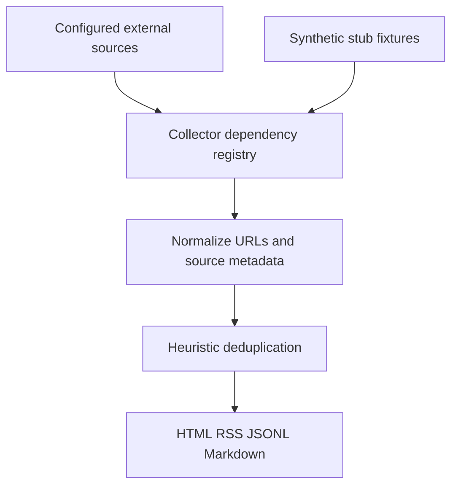

# Radar de Niko — Journal 44 · Studio Niko Design

**Node.js collector registry · Provenance-aware normalization · Territorial information outputs**

[Licence](LICENSE.md) · [Sécurité](SECURITY.md) · [Documentation du noyau](readme.md) · [English overview](#english-overview)

## Architecture réelle



| Source | Fonction constatée |
| --- | --- |
| [radar-registry.mjs](radar-registry.mjs) | Validation du graphe, exécution par niveaux, normalisation et dédoublonnage |
| [radar-agent-reach.mjs](radar-agent-reach.mjs) | Adaptateurs externes conditionnels |
| [radar-run.mjs](radar-run.mjs) | CLI, état des éléments vus et génération des sorties |
| [package.json](package.json) | Node.js >=18, scripts de tests existants |

Le rapprochement utilise notamment l'URL canonique, le média, une fenêtre temporelle conditionnelle de 36 heures et la similarité de Jaccard des mots du titre (seuil 0,88, au moins quatre tokens). La fusion privilégie certains types de sources et conserve la date la plus ancienne ; elle ne vérifie pas la véracité journalistique. Les rapprochements peuvent fusionner des sujets distincts ou manquer des doublons.

**Mode stub :** les fixtures contiennent des titres et noms de médias plausibles mais fictifs. Ne jamais publier ces sorties comme des faits. Le nom des fichiers générés ne constitue pas une protection contre leur confusion avec une collecte réelle. Prévoir un marquage visible et une séparation des répertoires et workflows avant publication.

Moteur Node.js de collecte et de restitution pour la veille territoriale autour de Châteaubriant / Loire-Atlantique. Le dépôt **n'héberge pas une page web directement à la racine** : les pages HTML sont générées par `radar-run.mjs` dans `dist/`.

## Architecture présente dans le code

- `radar-run.mjs` : point d'entrée CLI, paramètres et génération des fichiers.
- `radar-registry.mjs` : registre et orchestrateur des collecteurs.
- `radar-agent-reach.mjs` : adaptateurs et sources externes (configuration et autorisations potentiellement nécessaires).
- `radar-page.mjs`, `radar-daily.mjs`, `radar-v3.mjs` : HTML de restitution et visualisations.
- `radar-services.mjs` : collecte de services quotidiens.
- `public/` : ressources PWA copiées dans le répertoire de sortie.

## Commande de génération (exemple documentaire, non exécuté)

```bash
node radar-run.mjs --query "Châteaubriant" --out ./dist
```

Le script produit notamment : `dist/index.html`, `dist/quotidien.html`, `dist/radar.xml`, `dist/radar.jsonl`, `dist/radar.md`, `dist/v3/index.html`, `dist/v3/radar-v3.json` et `dist/facebook.txt`. Certains fichiers additionnels, comme `services.json`, dépendent du mode.

## Attention à la provenance

`node radar-run.mjs --stub` produit **uniquement des données fictives de démonstration**. Ne jamais publier ces résultats comme des actualités réelles. En mode normal, les collecteurs nécessitent des services externes accessibles et, selon les plateformes, des clés ou quotas. Les sources non configurées peuvent être ignorées et une collecte peut échouer.

`--only` limite les sources ; `--since` filtre les dates ; `--state` mémorise les éléments déjà vus entre deux exécutions. Les dates et les liens doivent conserver leur provenance. Aucun accès permanent aux plateformes externes n'est garanti.

## Révision web et sécurité

Voir `AGENTS.md` : Modern Web Guidance s'applique à la génération HTML/PWA, au responsive, à l'accessibilité et à la performance. Ne jamais committer `.env`, secrets de fournisseurs ni jetons.

**État de la présente révision :** documentation reconstituée après lecture des modules, sans exécution du collecteur, sans vérification des APIs et sans publication de sortie.


## Qualification proposée

Utiliser des fixtures isolées et explicitement fictives pour comparer les URL canoniques, doublons, dates et sources, les erreurs partielles et l'absence de résultats. Vérifier la provenance et les droits de réutilisation avant diffusion ; les textes satiriques et les actualités doivent être distingués. Le code prévoit un état d'échec lorsque toutes les sources sélectionnées sont indisponibles. Les tests présents ne constituent pas une preuve d'exécution nouvelle. Aucun collecteur lancé, aucune actualité publiée, aucun service externe interrogé pour cette révision.

## English overview

Radar de Niko is a Node.js territorial news collector registry with dependency scheduling, normalized provenance, heuristic deduplication and generated HTML/RSS/JSONL/Markdown outputs. Its title similarity and source preference rules do not verify facts. Stub fixtures are fabricated and must remain separate from news publication. Source rights, API access and freshness require independent checks. No new collection, test or deployment was performed.

[Notice de droits](LICENSE.md) : droits réservés pour les contributions originales concernées ; les sources, médias et composants tiers conservent leurs droits.
